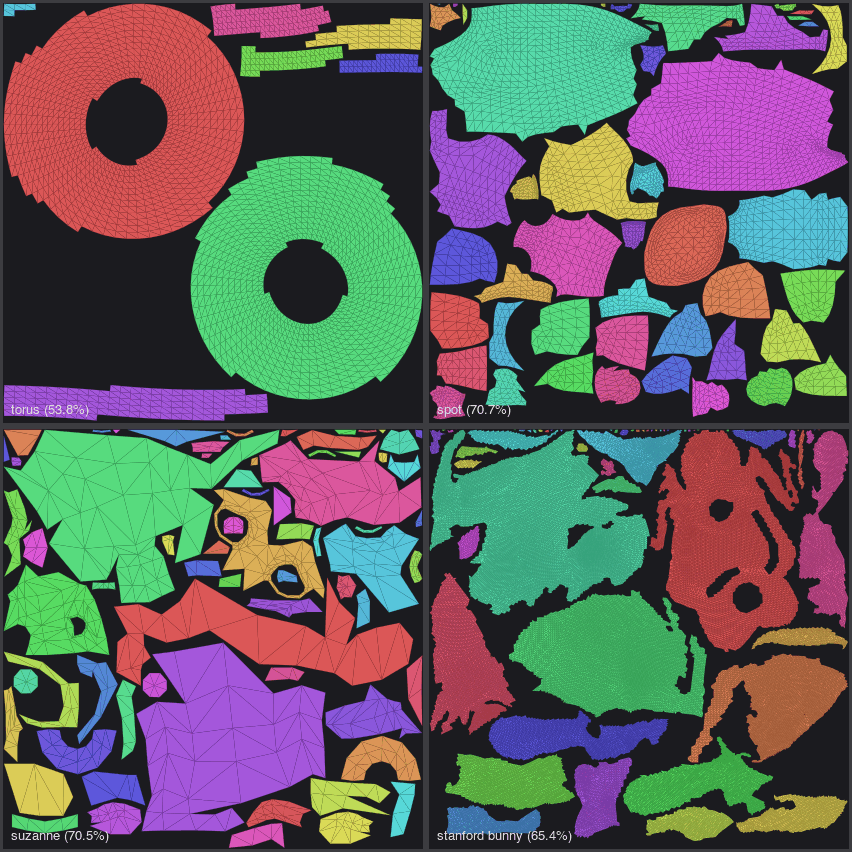

# uvunwrap

Pure-Rust automatic UV unwrapping: generates unique, non-overlapping texture
coordinates for lightmaps, texture baking and texture painting. Inspired by
[xatlas](https://github.com/jpcy/xatlas), with no C++ toolchain required, so it
builds for wasm and cross-compiles trivially.



## Usage

```rust
let mesh = uvunwrap::MeshInput { positions: &positions, indices: &indices, ..Default::default() };
let atlas = uvunwrap::generate(&[mesh], &uvunwrap::Options::default())?;

for v in &atlas.meshes[0].vertices {
    // v.xref: original vertex index, v.uv: [0, 1] coordinate, v.page: atlas page
}
```

`generate_with_progress` takes a callback that receives the current stage and
done/total counts and can return `false` to cancel, for running large unwraps
as background tasks.

Output meshes keep the input triangles in order; vertices on chart seams are
duplicated, and `xref` maps each one back to its input vertex.

Pass meshes as your engine stores them, with vertices split for normals and
UVs: identical positions are welded, and the split edges (hard edges, UV
seams) become chart boundaries. Optional per-mesh inputs:

- `face_materials`: charts never span two materials.
- `face_ignore`: faces that get no UV space.
- `scale`: mesh-to-world scale, so differently scaled instances share one
  texel density.
- `instances`: one scale per instance of a mesh drawn several times. The mesh
  is unwrapped once (its UVs cover `[0, 1]`) and each instance gets its own
  rectangle in the atlas (`OutputMesh::instances`), the way engines lightmap
  shared meshes (e.g. Bevy's `Lightmap::uv_rect`). With one instance this
  also keeps a mesh on a single page.

Try it on an OBJ file (writes an OBJ with `vt` coordinates plus an SVG per page):

```sh
cargo run --release --example unwrap -- model.obj out/model
```

## How it works

1. **Topology**: welds identical positions, drops triangles too thin for f32
   UVs (and ignored ones), and connects faces only across manifold,
   consistently oriented edges within one material that the input doesn't
   split. Split edges are ignored when most edges are split (flat shading).
2. **Segmentation**: grows charts from the largest planar regions, xatlas
   style: candidates are ranked by normal deviation (on crease-preserving
   smoothed normals, limited by `max_chart_angle`), with bonuses for filling
   boundary notches and penalties for crossing creases. Small charts mostly
   enclosed by a neighbor are merged, and single-triangle teeth are smoothed
   off the boundaries.
3. **Parameterization**: planar projection for flat charts, otherwise Least
   Squares Conformal Maps solved by sparse Cholesky. Results with flipped
   triangles, overlaps or area distortion above `max_area_distortion` are split
   and retried, so output is always valid. Large, strongly curved charts are
   split without attempting a solve.
4. **Packing**: charts are rotated to their minimum-area bounding rectangle,
   rasterized (conservatively, dilated by the padding) and packed by shape, so
   they nest into each other's concavities and holes, with 90° rotations.
   Texel density is automatic (fit one page) or fixed (one growing page, or
   multiple fixed-size pages). `Packing::Rect` packs bounding rectangles with
   a skyline packer instead: faster, but less dense. `max_chart_size` scales
   oversized charts down; `block_align` gives every chart its own 4×4 texel
   blocks for block-compressed lightmaps.

## Features

| Feature | Default | Effect |
|---|---|---|
| `direct-solver` | yes | Sparse Cholesky via pure-Rust `faer`; about 10× faster on large charts. Without it, an iterative CGLS solver is used. |
| `parallel` | yes | Parameterizes charts in parallel with `rayon`. Disable for wasm32 without threads. |

With no default features the crate has zero dependencies.

## Determinism

The same input, options and features give bit-identical output on any thread
count. No platform math library calls are used, so without `direct-solver`
output depends only on IEEE-754 arithmetic and should match across platforms
(x86-64, ARM, wasm32). With `direct-solver`, faer selects SIMD kernels at
runtime, so output can differ between CPU architectures. If you cache unwraps
or bake on one machine and ship to another, build without it. The `unwrap`
example prints an output hash for comparing builds.

## Performance

1024×1024 page, 2 texels of padding, release build, Apple M5 (10 cores). Utilization
is true surface area over atlas area.

| Model | Triangles | Charts | Single core | Multi-core | Utilization |
|---|---|---|---|---|---|
| Spot | 5.9K | 38 | 34 ms | 19 ms | 68% |
| Stanford bunny | 69K | 58 | 0.19 s | 82 ms | 65% |
| Armadillo | 100K | 257 | 0.40 s | 0.16 s | 60% |
| Nefertiti | 100K | 456 | 0.74 s | 0.40 s | 64% |
| Igea | 269K | 83 | 0.96 s | 0.48 s | 66% |

`cargo bench` runs criterion benchmarks on procedural meshes, plus any of
`spot`, `beetle`, `bunny`, `armadillo` and `nefertiti` found in `models/` (from
[common-3d-test-models](https://github.com/alecjacobson/common-3d-test-models)).

## Status and roadmap

- **Determinism**: cross-platform identical output with the fast direct
  solver too, and CI comparing output hashes across architectures.
- **Repacking existing UVs** without re-segmenting.
- **Integrations** (after the above): a Bevy crate.

## License

MIT
